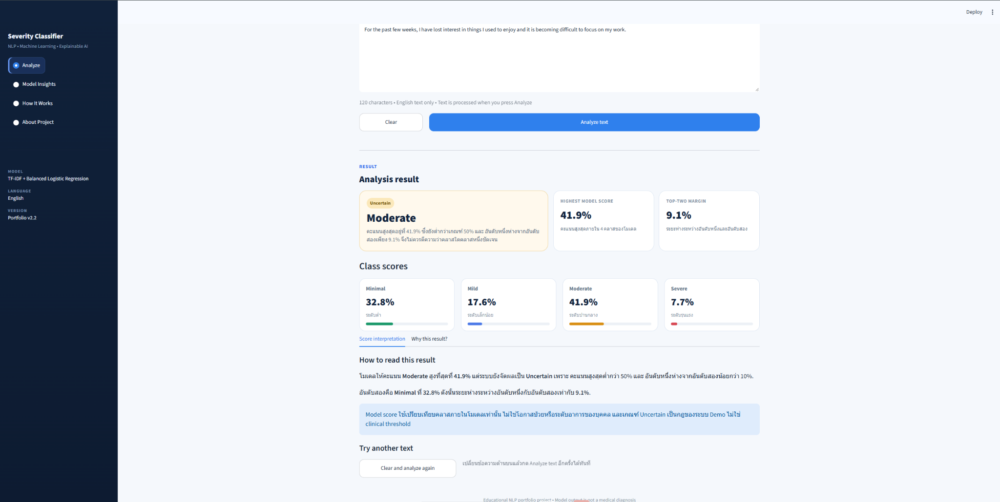

# Depression Severity Text Classifier

An end-to-end NLP portfolio project for classifying English text into four dataset labels:

- Minimal
- Mild
- Moderate
- Severe

The project covers data preparation, baseline modeling, model comparison, cross-validation, error analysis, explainability, and interactive deployment with Streamlit.

> Educational / portfolio prototype only. The output is not a medical diagnosis, clinical risk score, or emergency detection system.

---

## Application preview



### Additional views

- Model Insights: evaluation, class distribution, model comparison and confusion matrix
- How It Works: prediction pipeline, model rationale and explainability

## Live application

Public deployment: **Coming soon**

Run locally:

```bash
py -m streamlit run app.py
```

---

## Project highlights

- Cleaned and prepared the Reddit Depression Dataset
- Compared multiple classical NLP models
- Selected the final method using **Macro F1** because the dataset is imbalanced
- Added uncertainty handling using top-score and top-two-margin rules
- Added feature-level explainability using Logistic Regression coefficients
- Built a multi-page Streamlit portfolio application
- Included model insights, confusion matrix, class distribution, and behavioral sanity tests

---

## Dataset

The raw dataset file is kept locally at `data/Reddit_depression_dataset.csv` for the training scripts, but is excluded from Git by default. Before redistributing the raw dataset publicly, verify the dataset source and redistribution terms.

After cleaning and duplicate removal:

| Class | Records |
|---|---:|
| Minimal | 2,568 |
| Mild | 290 |
| Moderate | 394 |
| Severe | 282 |
| **Total** | **3,534** |

The dataset is highly imbalanced, with Minimal representing roughly 73% of cleaned records.

---

## Selected model

**TF-IDF (Unigram + Bigram) + Balanced Logistic Regression**

Main settings:

```text
TF-IDF
- ngram_range = (1, 2)
- min_df = 2
- max_df = 0.95
- sublinear_tf = True

Logistic Regression
- class_weight = "balanced"
- random_state = 42
```

`class_weight="balanced"` increases the training importance of minority classes without generating synthetic samples.

---

## Evaluation

### 5-Fold Stratified Cross-Validation

| Metric | Result |
|---|---:|
| Mean Accuracy | 71.60% |
| Mean Macro F1 | **44.24%** |
| Macro F1 Std. Dev. | ~3.1% |

### Holdout Test

| Metric | Result |
|---|---:|
| Accuracy | **70.58%** |
| Macro F1 | **45.60%** |
| Weighted F1 | 70.20% |

Macro F1 was prioritized over Accuracy because each class should contribute equally to model selection despite class imbalance.

---

## Why Accuracy alone is not enough

A majority-class dummy baseline can achieve relatively high Accuracy simply by predicting the dominant Minimal class.

However, its Macro F1 is very low.

This demonstrates why **Macro F1** is more informative for this project than Accuracy alone.

---

## Explainability

The web application can show which text features increased or reduced the linear score of the predicted class.

For a feature \(j\) and class \(c\):

```text
Feature contribution = TF-IDF value × Logistic Regression coefficient
```

This explains the internal calculation of the linear model.

It does **not** mean that a word or phrase is medically causal or clinically meaningful.

---

## Prediction clarity

The portfolio application uses a demonstration-only clarity rule:

```text
Uncertain:
top score < 50%
OR
top-two margin < 10%

Clearer prediction:
top score >= 65%
AND
top-two margin >= 15%
```

These thresholds are UI / demo rules only.

They are **not clinical thresholds** and have not been calibrated for medical decision-making.

---

## Application pages

### Analyze
- Enter or select English text
- View all four class scores
- View prediction clarity
- Read score interpretation
- Inspect supporting and score-reducing features

### Model Insights
- Dataset distribution
- Model comparison
- Cross-validation summary
- Holdout metrics
- Normalized confusion matrix
- Behavioral sanity test

### How It Works
- Prediction pipeline
- Why TF-IDF
- Why Balanced Logistic Regression
- Explainability calculation
- System limitations

### About Project
- Project scope
- Technical stack
- Evaluation highlights
- Known limitations
- Responsible-use boundary

---

## Tech stack

- Python
- pandas
- scikit-learn
- joblib
- Streamlit
- Altair
- Matplotlib

---

## Project structure

```text
depression_ai_starter2/
│
├── app.py
├── models/
│   ├── deployment_text_classifier.joblib
│   └── deployment_model_metadata.json
│
├── results/
│   ├── cross_validation_results.csv
│   ├── model_comparison.csv
│   ├── final_test_metrics.json
│   ├── final_test_confusion_matrix.png
│   └── final_test_confusion_matrix_normalized.png
│
├── src/
│   ├── inference.py
│   └── project_data.py
│
├── 01_explore_data.py
├── 02_train_baseline.py
├── ...
├── 13_streamlit_app.py
│
├── assets/
│   ├── app_result.png
│   ├── model_insights.png
│   └── how_it_works.png
│
├── requirements.txt
├── README.md
└── .gitignore
```

The numbered Python files preserve the experiment history.  
`app.py` is the current portfolio application.

---

## Run locally

### 1. Clone or download the repository

After cloning the repository, open a terminal in the project directory.

### 2. Install dependencies

```bash
py -m pip install -r requirements.txt
```

### 3. Start the application

```bash
py -m streamlit run app.py
```

Open:

```text
http://localhost:8501
```

---

## Model limitations

- The dataset is imbalanced.
- Mild is the most difficult class for the current model.
- TF-IDF does not understand language context as deeply as modern language models.
- Negation, sarcasm, third-person references, and out-of-domain text can be difficult.
- Behavioral tests are sanity checks, not clinical validation.
- The model should not be used for diagnosis or emergency-risk detection.

---

## Responsible use

This project was created for educational and portfolio purposes.

The labels and model scores describe the behavior of the trained classifier. They should not be interpreted as a medical diagnosis, probability of illness, or clinical recommendation.

---

## Author

**Nattawut Poonpattanamethee**  
Computer Science  
Nakhon Pathom Rajabhat University

---

## Project status

- Model evaluation: Complete
- Explainability: Enabled
- Portfolio web application: Complete
- Public deployment: Next step
